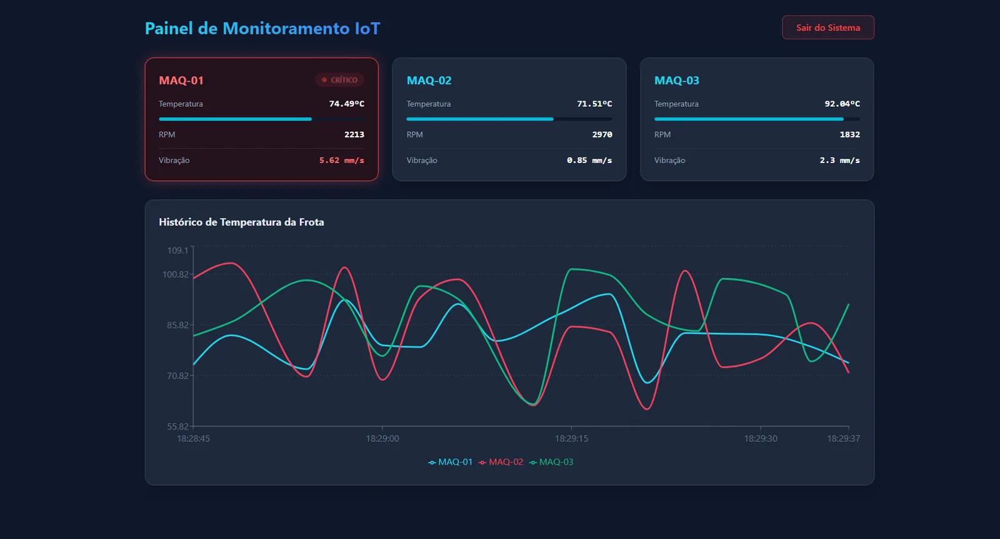
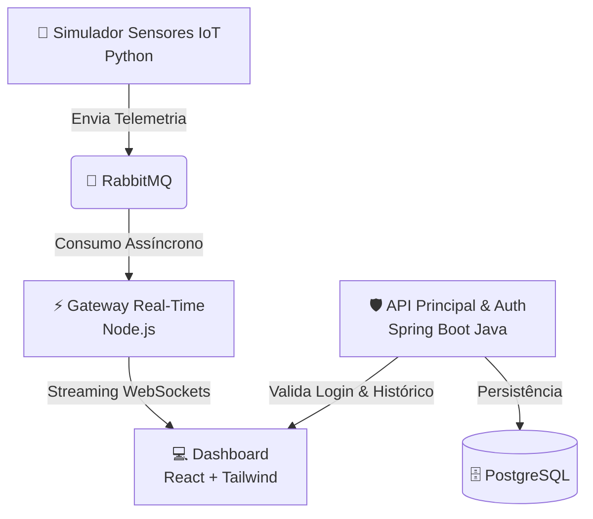

# 🏭 Plataforma de Monitoramento IoT Industrial


[](https://github.com/MatheusFranciscoLS/plataforma-iot-industrial/actions/workflows/ci.yml)

> 🟢 **Acesse o painel rodando na nuvem:** [Clique aqui para abrir o Dashboard](https://plataforma-iot-industrial.vercel.app)
> *(Utilize as credenciais de teste disponíveis no final da página para entrar)*

Uma arquitetura de microsserviços ponta a ponta para monitoramento em tempo real de telemetria de máquinas industriais (Temperatura, RPM e Vibração), protegida por autenticação criptográfica JWT e orquestrada inteiramente em containers Docker.

---

# 📸 Painel em funcionamento

<p align="center">
  
</p>

A máquina em estado crítico (MAQ-01) é destacada em vermelho; o gráfico mostra o histórico de temperatura da frota.

---

# ✨ Funcionalidades Principais

- **Streaming em Tempo Real:** Visualização instantânea da telemetria das máquinas via WebSockets, com atraso inferior a 1 segundo.
- **Alertas Dinâmicos:** Interface reativa que destaca máquinas em estado crítico (ex: Temperatura > 95°C ou Vibração > 5.0 mm/s) com efeitos visuais e mudança de cores.
- **Histórico Consolidado:** Gráfico interativo desenhando a linha do tempo da temperatura de toda a frota, consumido diretamente do banco relacional.
- **Segurança Ponta a Ponta:** Rotas da API REST e conexões de WebSocket totalmente protegidas por JSON Web Tokens (JWT).

---

# 🗺️ Arquitetura Visual

O fluxo de dados segue um padrão de produtor-consumidor, garantindo que o sistema continue estável mesmo sob alta carga de dados dos sensores IoT.



---

# 🛠️ Stack por Serviço

| Serviço | Tecnologia Base | Bibliotecas / Ferramentas |
|---|---|---|
| Frontend UI | React.js (Vite) | Tailwind CSS, Recharts, Socket.io-client |
| Gateway Real-Time | Node.js | Express, Socket.io, JsonWebToken, Amqplib |
| API Core & Auth | Java 21 | Spring Boot, Spring Security, io.jsonwebtoken |
| Mensageria | RabbitMQ | Protocolo AMQP, RabbitMQ Management |
| Banco de Dados | PostgreSQL | JPA/Hibernate via Spring |
| Simulador IoT | Python 3 | Pika, Time, Random |
| Infraestrutura | Docker | Docker Compose, Multi-container network |

---

# 🔒 Camada de Segurança (JWT Multi-Serviço)

O ecossistema implementa uma arquitetura de segurança descentralizada:

- O **Spring Boot** valida as credenciais e emite o token assinado.
- O **React** armazena o token e o envia:
  - No cabeçalho `Authorization` para requisições REST.
  - No objeto de autenticação do WebSocket.
- O **Node.js** intercepta a conexão WebSocket e valida a assinatura JWT antes de liberar o streaming em tempo real.

---

# 🚀 Como Executar o Projeto

Graças à conteinerização com Docker, você pode subir todo o ecossistema com apenas um comando.

## 📋 Pré-requisitos

- Docker
- Docker Compose

---

## ▶️ Passo a Passo

### 1. Clone o repositório

```bash
git clone https://github.com/MatheusFranciscoLS/plataforma-iot-industrial.git

cd plataforma-iot-industrial
```

### 2. Inicialize os containers

```bash
docker compose up -d --build
```

---

# 🌐 Serviços Disponíveis

| Serviço | URL |
|---|---|
| Dashboard React | http://localhost:5173 |
| API Java Spring | http://localhost:8080 |
| RabbitMQ Management | http://localhost:15672 |

---

# 💡 Credenciais de Teste

```txt
Usuário: admin
Senha: senha123
```

---

# ✅ Testes Automatizados

A API Java (`iot-core`) tem **23 testes automatizados**, que rodam a cada push na `main` e a cada pull request no GitHub Actions (o selo no topo mostra o resultado).

| O que é testado | Como |
|---|---|
| Geração do token JWT: usuário no token, validade de 2 horas, assinatura que não vale com outra chave | Teste unitário |
| Filtro de segurança: token válido autentica; sem token, token inválido, adulterado, expirado, assinado com outra chave ou sem `Bearer` não autentica | Teste unitário |
| Login (`/api/auth/login`): senha certa devolve token; senha ou usuário errado devolve 401 | Aplicação completa com banco H2 em memória |
| Rotas protegidas: `GET /api/sensores` é bloqueado sem token ou com token inválido e liberado com token válido | Aplicação completa |
| Entrada de dados: `POST /api/sensores` salva a leitura, envia para a fila `sensores.fila` e continua respondendo 200 mesmo se o RabbitMQ falhar | Aplicação completa, RabbitMQ simulado |
| Histórico: no máximo 60 registros, do mais novo para o mais antigo; data de recebimento preenchida ao salvar | Teste de repositório (JPA + H2) |

Para rodar na sua máquina (precisa de Java 21):

```bash
cd iot-core
./mvnw test
```

---

# 🧭 Decisões e o que aprendi

## Decisões de projeto

- **Salvar primeiro, avisar depois.** A API grava a leitura no banco e só então publica na fila do RabbitMQ, com o erro da fila tratado à parte. O teste `seOBrokerFalharALeituraContinuaSalvaEARespostaEhOk` garante que, com a fila falhando, a leitura continua salva e a resposta é 200.
- **Fila entre a API e o painel.** O gateway Node consome a fila `sensores.fila` e entrega cada leitura por WebSocket (evento `novoRegistro`); o histórico do gráfico vem da API REST.
- **Um único segredo para o JWT nos dois serviços.** O Spring Boot emite o token e o Node valida a assinatura com a mesma chave, sem precisar chamar a API Java a cada conexão WebSocket.
- **Sensores enviam sem login.** `POST /api/sensores` é aberto para que o simulador (e, em um caso real, os equipamentos) não precisem de token. Já a leitura do histórico exige token.
- **Testes sem serviços externos.** Os testes usam banco H2 em memória e um RabbitMQ simulado, então rodam em qualquer máquina e no CI sem Docker.

## O que aprendi

- **O único teste que existia estava quebrado.** O `contextLoads` falhava porque o arquivo de propriedades de teste não tinha a chave do JWT. Sem CI, nada avisava isso. Hoje o CI roda todos os testes a cada mudança.
- **Testar a segurança de ponta a ponta vale mais que testar só a classe.** Os testes de `JwtFilter` e `TokenService` isolados passariam mesmo com a regra de rotas errada. Os testes com a aplicação inteira é que provam que `/api/sensores` realmente exige token.
- **Sem token, o Spring Security 7 responde 403, não 401.** Isso aparece nos testes: a configuração não define uma resposta própria para requisições sem autenticação, então vale o comportamento padrão.
- **Versão do Java importa.** O projeto compila para Java 21 (`pom.xml` e `Dockerfile`); por isso o CI usa Java 21.

## Limitações conhecidas e próximos passos

- Existe um único usuário fixo no código (`admin`); o próximo passo natural é ter usuários no banco com senha criptografada.
- A configuração de CORS aceita qualquer origem (`*`).
- `POST /api/sensores` não exige autenticação (veja acima).
- Só a API Java tem testes automatizados; o gateway Node, o painel React e o simulador Python ainda não têm.

---

# 📈 Tecnologias e Conceitos Aplicados

- Microsserviços
- Mensageria Assíncrona
- Arquitetura Event-Driven
- WebSockets
- JWT Authentication
- Dockerização
- Comunicação em Tempo Real
- Producer / Consumer Pattern
- APIs REST
- Persistência Relacional
- Containers Multi-serviço

---

# 👨‍💻 Autor

Desenvolvido por Matheus Francisco.