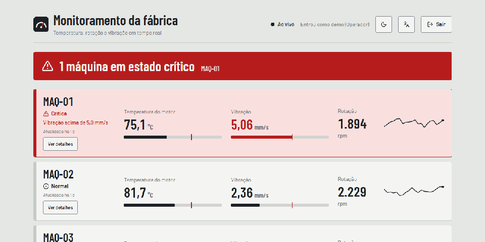
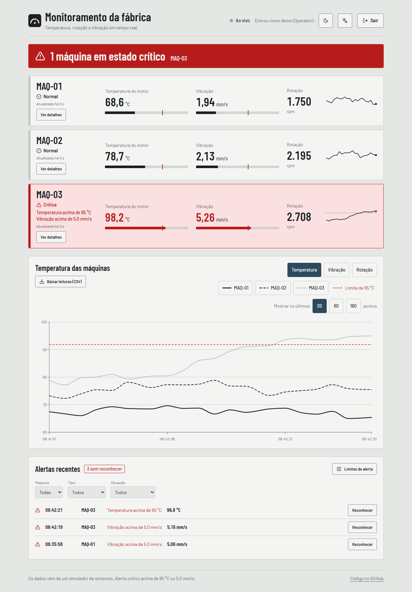
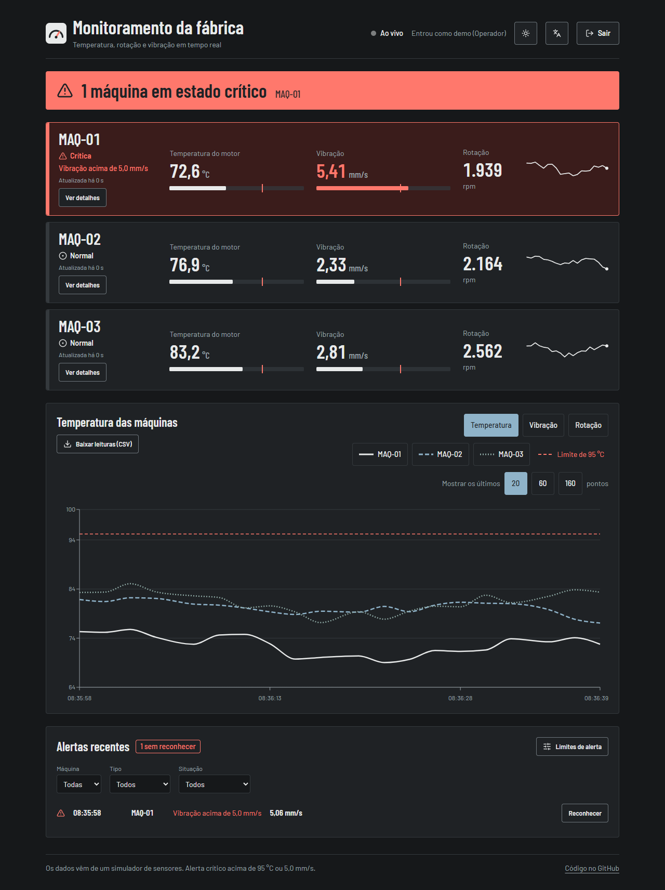
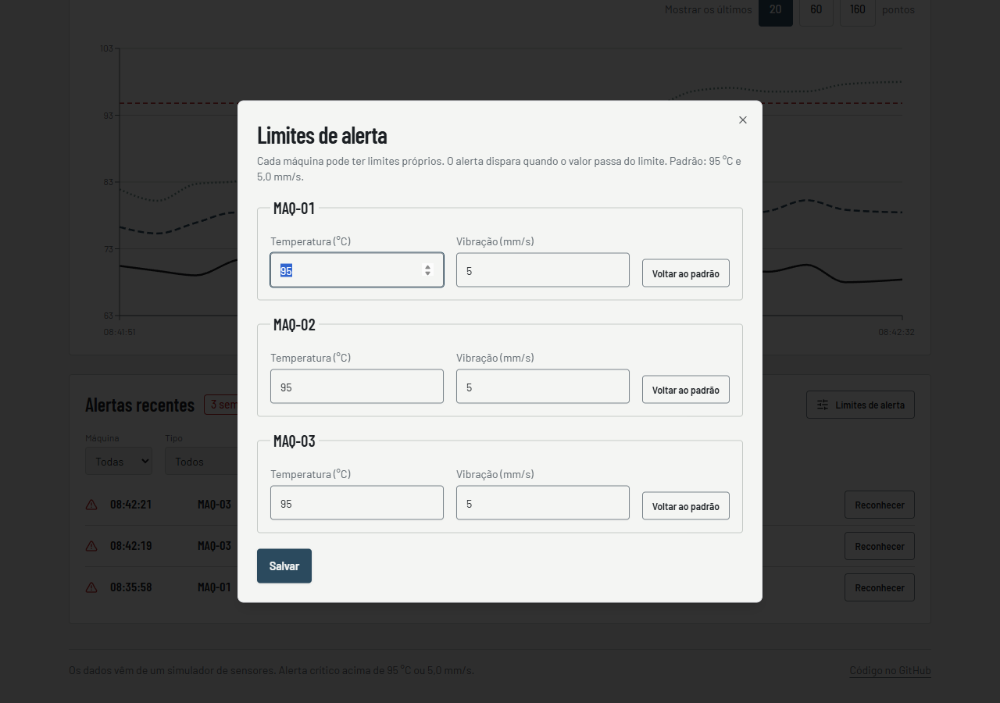
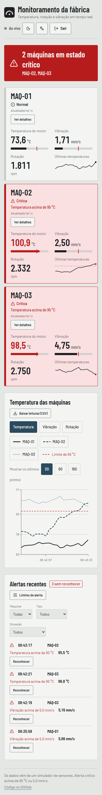
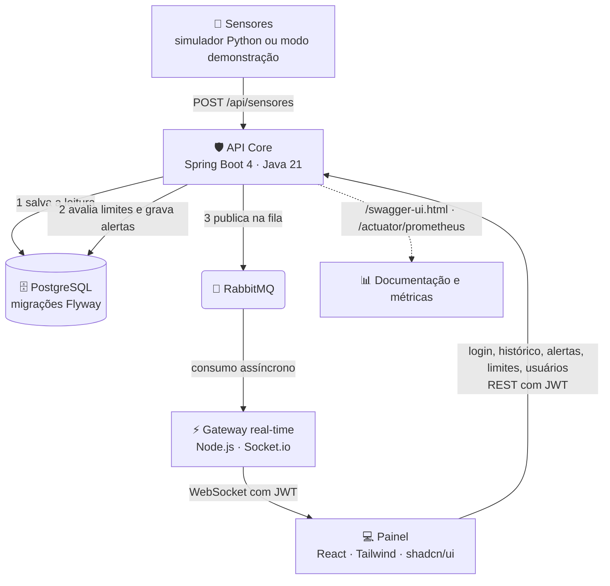

# 🏭 Plataforma de Monitoramento IoT Industrial


[](https://github.com/MatheusFranciscoLS/plataforma-iot-industrial/actions/workflows/ci.yml)

> 🟢 **Acesse o painel rodando na nuvem:** [Clique aqui para abrir o Dashboard](https://plataforma-iot-industrial.vercel.app)
> *(Utilize as credenciais de teste disponíveis no final da página para entrar)*

Uma arquitetura de microsserviços ponta a ponta para monitoramento em tempo real de telemetria de máquinas industriais (Temperatura, RPM e Vibração), protegida por autenticação criptográfica JWT e orquestrada inteiramente em containers Docker.

---

# 📸 Painel em funcionamento

<p align="center">
  
</p>

O painel publicado, com leituras de um simulador de sensores (os números mudam sozinhos, em tempo real). Uma máquina que passa do limite fica destacada em vermelho e gera um alerta.

<p align="center">
  
  
</p>

<p align="center">
  
  
</p>

O painel funciona em tela de computador e de celular, em tema claro e escuro, em português e em inglês, e passou por uma auditoria automática de acessibilidade (axe) e por testes de navegação só pelo teclado.

---

# ✨ Funcionalidades Principais

- **Streaming em Tempo Real:** telemetria das máquinas via WebSockets; se o tempo real falhar, o painel avisa e busca as leituras na API a cada 3 segundos.
- **Alertas completos:** a API registra um alerta quando uma máquina passa do limite (padrão 95 °C e 5,0 mm/s). Cada máquina pode ter o seu limite, os alertas se reconhecem (quem viu e quando) e a lista filtra por máquina, tipo e situação.
- **Demonstração interativa:** no site publicado, o botão "Simular falha" de cada máquina provoca uma falha na hora, para ver a faixa vermelha, o alerta na lista e (se ligado) a mensagem no chat sem esperar.
- **Histórico e gráfico interativo:** temperatura, vibração ou rotação, escolha de máquinas, ao vivo ou por período (1 hora, 6 horas ou 24 horas, com médias calculadas no servidor) e exportação em CSV.
- **Comparação e detalhe por máquina:** uma tabela compara as máquinas no período (média, máximo, rotação e alertas, com barras) e a janela de cada máquina tem o seu gráfico de média e máximo, com a linha do limite dela.
- **Usuários e perfis:** administrador (gerencia usuários), operador (reconhece alertas e troca limites) e somente leitura, com tela de usuários no painel.
- **Segurança ponta a ponta:** rotas REST e WebSocket protegidas por JWT, senhas em BCrypt, limite de tentativas no login e na troca de senha, chave dos tokens por variável de ambiente, troca da própria senha e renovação automática do token (sessão limitada a 12 horas desde o login).
- **API documentada e observável:** documentação interativa em `/swagger-ui.html` e métricas em formato Prometheus.
- **Qualidade:** testes automatizados nos quatro serviços, testes da API contra um PostgreSQL de verdade, teste no navegador e CI que sobe tudo com Docker Compose a cada mudança.

---

# 🗺️ Arquitetura Visual

O caminho de uma leitura segue um padrão de produtor-consumidor: a API Java recebe e guarda a leitura, avisa a fila, e o gateway entrega ao painel em tempo real. Se a fila ou o tempo real falharem, a leitura continua salva e o painel busca na API.



Perfis de acesso (o perfil vai dentro do token e a regra fica na API):

| Perfil | Vê tudo | Reconhece alertas e troca limites | Gerencia usuários |
|---|:-:|:-:|:-:|
| Administrador | ✅ | ✅ | ✅ |
| Operador | ✅ | ✅ | ❌ |
| Somente leitura | ✅ | ❌ | ❌ |

---

# 🛠️ Stack por Serviço

| Serviço | Tecnologia Base | Bibliotecas / Ferramentas |
|---|---|---|
| Frontend UI | React 19 (Vite) | Tailwind CSS, shadcn/ui (Radix), Recharts, Socket.io-client, Vitest, Testing Library, Playwright |
| Gateway Real-Time | Node.js | Express, Socket.io, JsonWebToken, Amqplib |
| API Core & Auth | Java 21 · Spring Boot 4 | Spring Security, JWT (jjwt), JPA/Hibernate, Flyway, springdoc (OpenAPI), Micrometer + Prometheus, Testcontainers |
| Mensageria | RabbitMQ | Protocolo AMQP |
| Banco de Dados | PostgreSQL | Migrações versionadas com Flyway |
| Simulador IoT | Python 3 | Requests |
| Infraestrutura | Docker · GitHub Actions | Docker Compose, CI com testes e teste no navegador; hospedagem em Render, Vercel, Supabase e CloudAMQP (planos gratuitos) |

---

# 🔒 Camada de Segurança (JWT Multi-Serviço)

O ecossistema implementa uma arquitetura de segurança descentralizada:

- O **Spring Boot** valida as credenciais e emite o token assinado.
- O **React** armazena o token e o envia:
  - No cabeçalho `Authorization` para requisições REST.
  - No objeto de autenticação do WebSocket.
- O **Node.js** intercepta a conexão WebSocket e valida a assinatura JWT antes de liberar o streaming em tempo real.

---

# 🚀 Como Executar o Projeto

Graças à conteinerização com Docker, você pode subir todo o ecossistema com apenas um comando.

## 📋 Pré-requisitos

- Docker
- Docker Compose

---

## ▶️ Passo a Passo

### 1. Clone o repositório

```bash
git clone https://github.com/MatheusFranciscoLS/plataforma-iot-industrial.git

cd plataforma-iot-industrial
```

### 2. Inicialize os containers

```bash
docker compose up -d --build
```

---

# 🌐 Serviços Disponíveis

| Serviço | URL |
|---|---|
| Dashboard React | http://localhost:5173 |
| API Java Spring | http://localhost:8080 |
| RabbitMQ Management | http://localhost:15672 |

---

# 💡 Credenciais de Teste

```txt
Demonstração (perfil OPERADOR: vê tudo, reconhece alertas e troca limites)
Usuário: demo
Senha: demo123

Administrador local (perfil ADMIN: também gerencia usuários)
Usuário: admin
Senha: senha123
```

Em produção, troque a senha do `admin` (tela de usuários do painel) ou defina `ADMIN_SENHA` antes da primeira subida: essa senha padrão é pública.

---

# ✅ Testes Automatizados

A API Java (`iot-core`, 139 testes), o painel React (`painel-react`, 127 testes com Vitest e Testing Library), o gateway Node (`servidor-node`, 12 testes), o simulador Python (`simulador-python`, 6 testes) e o teste no navegador (`e2e`, 5 testes com Playwright, contra tudo rodando no Docker Compose) rodam a cada push na `main` e a cada pull request no GitHub Actions (o selo no topo mostra o resultado). Dos 139 testes da API, 9 usam um PostgreSQL de verdade num container e rodam no CI; sem Docker na máquina eles são pulados.

O que os testes do gateway Node cobrem: porteiro de tokens (válido, ausente, outra chave, vencido, sem assinatura), mensagens estragadas da fila, reconexão com espera crescente e a lista de origens do CORS. Os do simulador cobrem os campos e as faixas das leituras e o envio (cabeçalho de chave e tempo limite).

| O que é testado | Como |
|---|---|
| Geração do token JWT: usuário no token, validade de 2 horas, assinatura que não vale com outra chave | Teste unitário |
| Filtro de segurança: token válido autentica; sem token, token inválido, adulterado, expirado, assinado com outra chave ou sem `Bearer` não autentica | Teste unitário |
| Login (`/api/auth/login`): senha certa devolve token; senha ou usuário errado devolve 401 | Aplicação completa com banco H2 em memória |
| Rotas protegidas: `GET /api/sensores` é bloqueado sem token ou com token inválido e liberado com token válido | Aplicação completa |
| Entrada de dados: `POST /api/sensores` salva a leitura, envia para a fila `sensores.fila` e continua respondendo 200 mesmo se o RabbitMQ falhar | Aplicação completa, RabbitMQ simulado |
| Histórico: no máximo 60 registros, do mais novo para o mais antigo; data de recebimento preenchida ao salvar | Teste de repositório (JPA + H2) |
| Perfis: leitura não reconhece alerta nem troca limite, operador não gerencia usuários, token sem perfil vale só como leitura, sem token é 401 e sem permissão é 403, o último administrador não sai | Aplicação completa |
| Alertas e limites: alerta só na passagem do limite, limite por máquina, reconhecer guarda quem viu, filtros da lista | Aplicação completa |
| Migrações e consultas no banco de produção: banco vazio e banco antigo do Hibernate recebem as migrações, e a API inteira roda com Flyway e `validate` | PostgreSQL 17 num container (Testcontainers) |
| Documentação e métricas: `/v3/api-docs` descreve as rotas, `/actuator/prometheus` só responde para administrador e conta leituras, alertas e falhas da fila | Aplicação completa |
| Painel: cartões, gráfico, alertas, limites, usuários, idioma, perfis, sessão vencida e erros de rede | Vitest + Testing Library; no navegador, Playwright |

Para rodar na sua máquina:

```bash
# API Java (precisa de Java 21)
cd iot-core && ./mvnw test

# Gateway Node
cd servidor-node && npm ci && npm test

# Simulador Python
cd simulador-python && pip install -r requirements.txt && python -m unittest -v

# Painel React
cd painel-react && npm ci && npm run lint && npm test
```

---

# 🧭 Decisões e o que aprendi

## Decisões de projeto

- **Salvar primeiro, avisar depois.** A API grava a leitura no banco e só então publica na fila do RabbitMQ, com o erro da fila tratado à parte. O teste `seOBrokerFalharALeituraContinuaSalvaEARespostaEhOk` garante que, com a fila falhando, a leitura continua salva e a resposta é 200.
- **Fila entre a API e o painel.** O gateway Node consome a fila `sensores.fila` e entrega cada leitura por WebSocket (evento `novoRegistro`); o histórico do gráfico vem da API REST.
- **Um único segredo para o JWT nos dois serviços.** O Spring Boot emite o token e o Node valida a assinatura com a mesma chave, sem precisar chamar a API Java a cada conexão WebSocket.
- **Sensores enviam sem login.** `POST /api/sensores` é aberto para que o simulador (e, em um caso real, os equipamentos) não precisem de token. Já a leitura do histórico exige token. Quem quiser fechar essa porta define `SENSOR_API_KEY` na API e no simulador: a API passa a exigir o cabeçalho `X-API-Key`.
- **O sensor não escolhe o `id`.** A API recebe a leitura em um objeto próprio (`LeituraRequest`), valida os campos (nome da máquina, timestamp, temperatura, vibração e rotação) e sempre cria um registro novo. Antes, a entidade do banco era recebida direto, e um `POST` com o `id` de um registro existente o sobrescrevia (há um teste para isso).
- **Usuários no banco, senha em BCrypt.** O login deixou de comparar com um texto fixo no código: os usuários ficam na tabela `usuario`, só com o hash da senha. Na primeira subida com o banco vazio a API cria o administrador (`admin`) e o usuário de demonstração (`demo`); em produção, `ADMIN_USUARIO` e `ADMIN_SENHA` trocam o acesso do administrador e `DEMO_USUARIO` vazio desliga o de demonstração. Se o administrador ainda usa a senha padrão, a API avisa no log.
- **Três perfis.** `ADMIN` gerencia usuários (`/api/usuarios`: criar, trocar senha e perfil, apagar) e faz tudo do operador; `OPERADOR` reconhece alertas e troca limites; `LEITURA` só olha. O perfil vai dentro do token e a regra fica no `SecurityConfig`. Token sem perfil vale só como `LEITURA`, e o sistema nunca fica sem administrador. O botão de demonstração entra como `demo` (operador), de propósito: quem visita pode testar alertas e limites, mas ninguém de fora cria ou apaga usuários no site público. Como o acesso de administrador do demo também é público, `PROTEGER_USUARIOS=true` trava o que poderia estragar o demo para o próximo visitante: o administrador inicial e o `demo` não podem ser apagados nem ter senha ou perfil trocados (423), ninguém cria ou promove outro administrador e há um teto de usuários (`MAX_USUARIOS`, padrão 25). Desligado por padrão, para uma instalação própria poder mexer em tudo. Usuário inexistente gasta o mesmo tempo de um usuário real, para o tempo de resposta não revelar quem existe.
- **Limite de tentativas no login.** Depois de 5 falhas seguidas do mesmo endereço para o mesmo usuário, o login responde 429 por 5 minutos (`LOGIN_MAX_TENTATIVAS` e `LOGIN_JANELA_SEGUNDOS` mudam isso). A contagem fica na memória, então reiniciar a API zera. Atrás da hospedagem o endereço vem do cabeçalho `X-Forwarded-For`.
- **Troca de senha e sessão que renova.** Qualquer usuário troca a própria senha (`PUT /api/auth/senha`, que confere a senha atual e tem o mesmo limite de tentativas do login; os usuários protegidos do demo recebem 423). O token continua durando 2 horas, mas o painel pede um novo (`POST /api/auth/renovar`) quando faltam 15 minutos, então quem está usando não é desconectado. A renovação relê o perfil do banco (uma promoção já vale na renovação), recusa usuário apagado e tem um teto: a sessão acaba 12 horas depois do login (`SESSAO_MAXIMA_HORAS`), porque um token roubado não pode se renovar para sempre. Em vez de refresh token, o próprio token válido é a credencial da renovação, sem nada guardado no servidor.
- **Histórico com filtro.** `GET /api/sensores` sem parâmetros continua devolvendo os 60 mais recentes; `?maquina=MAQ-01&limite=100` filtra uma máquina e escolhe o tamanho (de 1 a 500).
- **Rota de saúde.** `GET /actuator/health` fica aberta e só diz se a API e o banco estão no ar; o RabbitMQ fora do ar não derruba a saúde, porque a API salva as leituras mesmo assim.
- **Chave dos tokens por variável de ambiente.** A API e o gateway leem `JWT_SECRET` (a mesma nos dois). A chave de desenvolvimento que vem no repositório é pública: serve para rodar local, a API avisa no log quando ela está em uso, e uma chave com menos de 32 caracteres impede a API de subir. Em produção, defina `JWT_SECRET` com uma chave sua (`openssl rand -base64 48`, por exemplo).
- **Painel em português e inglês.** O painel escolhe o idioma pelo navegador na primeira visita e tem um botão para trocar (a escolha fica guardada). Os textos ficam em `painel-react/src/i18n/textos.js`, sem biblioteca externa; um teste confere que os dois idiomas têm as mesmas chaves e os mesmos `{valores}`. Números e horas seguem o formato do idioma (`99,5` em português, `99.5` em inglês).
- **Alertas no servidor, com limite por máquina e reconhecimento.** A API registra um alerta quando uma máquina passa de um limite (só no momento da passagem, sem repetir enquanto continua acima). Os limites padrão são 95 °C e 5,0 mm/s e cada máquina pode ter os seus (`GET/PUT/DELETE /api/limites`, guardados na tabela `limite_maquina`). Quem está de plantão marca o alerta como visto (`POST /api/alertas/{id}/reconhecer`, que guarda quem e quando), e a lista filtra por máquina, tipo e situação (`GET /api/alertas?maquina=&tipo=&reconhecido=`). No painel, o botão "Limites de alerta" edita os valores, o gráfico desenha a linha de cada limite e o contador mostra quantos alertas ninguém reconheceu.
- **Acordar rápido na hospedagem gratuita.** O plano gratuito do Render dorme a API sem visitas e a sobe com uma fração de CPU, então a primeira visita esperava mais de dois minutos (medi 147 s e 169 s). Três mudanças atacam isso: a imagem Docker guarda um arquivo CDS (as classes já lidas e verificadas, gerado no `docker build`) e sobe com o compilador rápido do Java (`-XX:TieredStopAtLevel=1`), o pool de conexões é pequeno e a tela de login chama a rota de saúde da API e do gateway assim que abre, para eles acordarem enquanto a pessoa lê a página. O painel também consulta menos: a contagem de alertas não reconhecidos vem a cada 15 s, não a cada 5 s. Para o custo continuar zero, ainda existe o "modo candidatura" (`.github/workflows/modo-candidatura.yml`): um agendamento do GitHub Actions que chama a API e o gateway a cada 10 minutos, mas só quando a variável de repositório `MANTER_ACORDADO` vale `true`. Fica desligado por padrão para não gastar as horas gratuitas da hospedagem; liga-se nos dias em que o projeto é divulgado. Acordar a API por completo, o tempo todo, só com plano pago (ou outro tipo de hospedagem): isso não se resolve com código.
- **Séries por período calculadas no servidor.** `GET /api/sensores/serie?periodo=1h|6h|24h` devolve a média e o máximo de temperatura e vibração e a rotação média por faixa de tempo (1 min, 5 min ou 15 min), agrupadas por uma consulta no banco: o painel recebe cerca de 100 pontos por máquina em vez de milhares de leituras. `GET /api/sensores/resumo?periodo=` traz, por máquina, leituras, média, máximo, mínimo e quantos alertas houve. O resultado fica 15 s em memória para vários painéis abertos não repetirem a mesma conta, e o relógio é um bean para os testes fixarem a hora e conferirem números exatos. O agrupamento usa divisão inteira do `timestamp`, e um teste no PostgreSQL real confirma que ele agrupa igual ao H2. No demo, a limpeza (`RETENCAO_HORAS=24`) limita o histórico a 24 horas.
- **Aviso de alertas num chat (webhook).** Com `ALERTA_WEBHOOK_URL` definida (o endereço de um webhook do Discord ou do Slack, que são grátis), cada alerta novo também vira uma mensagem no canal, como "⚠️ MAQ-02: temperatura acima do limite (98.2 °C, limite 95.0 °C) às 22:13:20". O envio é assíncrono e com tempo limite, então um chat fora do ar não atrasa nem derruba a leitura, e as falhas ficam em `iot_webhook_falhas_total`. `ALERTA_WEBHOOK_PAINEL_URL` põe o endereço do painel no fim da mensagem e `ALERTA_WEBHOOK_FUSO` escolhe o fuso da hora (padrão `America/Sao_Paulo`). Desligado por padrão. O corpo leva `content` e `text` com a mesma frase, então o mesmo endereço funciona nos dois.
- **API documentada e observável.** A documentação interativa fica em `/swagger-ui.html` (e o JSON em `/v3/api-docs`): pública, porque só descreve as rotas, e o botão "Authorize" aceita o token do login para testar as rotas protegidas. `DOCS_ATIVAS=false` desliga. As métricas ficam em `/actuator/prometheus` e `/actuator/metrics` e só respondem com token de administrador; além das métricas padrão do Spring (memória, requisições, banco), a API conta leituras recebidas por máquina (`iot_leituras_recebidas_total`), alertas gerados por tipo (`iot_alertas_gerados_total`), falhas de envio ao RabbitMQ (`iot_rabbitmq_falhas_total`) e quantos alertas ninguém reconheceu (`iot_alertas_pendentes`). `/actuator/health` continua aberta.
- **Migrações do banco com Flyway.** O esquema do banco é criado e alterado por scripts versionados em `iot-core/src/main/resources/db/migration`, e o Hibernate não mexe mais nas tabelas. Em um banco que já tinha as tabelas (criadas antes pelo Hibernate), o Flyway apenas marca a versão 1 como feita. O `MigracoesTest` cria o esquema só com as migrações e deixa o Hibernate conferir (`ddl-auto=validate`), então mudar uma entidade sem escrever a migração quebra o CI.
- **Modo demonstração.** Com `SIMULADOR_ATIVO=true`, a própria API gera leituras de teste das três máquinas, para o painel publicado funcionar sem um simulador rodando em outro lugar. Os valores variam devagar em torno do normal de cada máquina (como numa máquina de verdade, sem pular de 60 para 105 °C de uma leitura para a outra) e, de tempos em tempos, uma delas passa dos limites por algumas dezenas de segundos e volta ao normal: é isso que gera os alertas, em vez de um alerta a cada poucos segundos. Para quem visita o site não precisar esperar, operador e administrador têm o botão "Simular falha" em cada máquina (`POST /api/demo/falha/{maquina}`, que só existe com o modo demonstração ligado): a máquina passa dos limites por cerca de um minuto e volta ao normal sozinha, e o alerta aparece na lista na hora. Cada máquina só aceita um novo pedido depois de 30 s (resposta 429 com `Retry-After`). Com `RETENCAO_HORAS=24`, as leituras com mais de 24 horas são apagadas a cada 10 minutos, para o banco gratuito não encher. As duas variáveis vêm desligadas por padrão.
- **Mensagem estragada não trava a fila.** O gateway Node descarta (sem devolver à fila) a mensagem que não for um JSON com `idMaquina`, e reconecta no RabbitMQ sozinho, esperando 1 s, 2 s, 4 s... até 30 s.
- **Testes sem serviços externos.** Os testes usam banco H2 em memória e um RabbitMQ simulado, então rodam em qualquer máquina e no CI sem Docker.

## O que aprendi

- **O único teste que existia estava quebrado.** O `contextLoads` falhava porque o arquivo de propriedades de teste não tinha a chave do JWT. Sem CI, nada avisava isso. Hoje o CI roda todos os testes a cada mudança.
- **Testar a segurança de ponta a ponta vale mais que testar só a classe.** Os testes de `JwtFilter` e `TokenService` isolados passariam mesmo com a regra de rotas errada. Os testes com a aplicação inteira é que provam que `/api/sensores` realmente exige token.
- **Sem token, o Spring Security 7 responde 403 por padrão, e isso atrapalha os perfis.** Com perfis, "não sei quem você é" (401) e "sei, mas você não pode" (403) precisam ser respostas diferentes: o painel desloga no 401, mas só avisa no 403. Por isso a API define uma resposta 401 própria para quem não se identificou.
- **Versão do Java importa.** O projeto compila para Java 21 (`pom.xml` e `Dockerfile`); por isso o CI usa Java 21.

## Limitações conhecidas e próximos passos

- O CORS aceita qualquer origem (`*`) por padrão; em produção, defina `CORS_ORIGINS` na API Java e `CORS_ORIGIN` no gateway com o endereço do painel.
- `POST /api/sensores` não exige autenticação por padrão (veja `SENSOR_API_KEY` acima).
- O limite de tentativas do login, o estado "máquina estava acima do limite" (que evita alertas repetidos) e a cópia dos limites por máquina ficam na memória da API; com mais de uma instância, cada uma teria a sua. Hoje a API roda numa instância só.
- Não existe "esqueci minha senha" por e-mail: quem perde a senha depende de um administrador para trocá-la. Trocar a senha não derruba tokens já emitidos (valem até vencer, no máximo 2 horas), porque o token é sem estado.
- A API de demonstração fica na hospedagem gratuita: dorme sem visitas e leva cerca de um minuto para acordar (a tela de login já a acorda ao abrir). Os dados do demo vêm de um simulador, não de sensores reais.
- Próximos passos possíveis: recuperação de senha por e-mail, aviso de alerta por e-mail, guardar o estado que hoje fica na memória (limites de tentativas, "estava acima do limite") num Redis para rodar mais de uma instância, e um teste de carga.

---

# 📈 Tecnologias e Conceitos Aplicados

- Microsserviços
- Mensageria Assíncrona
- Arquitetura Event-Driven
- WebSockets
- JWT Authentication e controle de acesso por perfil (RBAC)
- Migrações de banco versionadas (Flyway)
- Testes automatizados em vários níveis (unidade, integração, PostgreSQL real, navegador) e CI
- Observabilidade (métricas Prometheus) e documentação de API (OpenAPI)
- Acessibilidade e internacionalização (PT/EN) no front-end
- Dockerização
- Comunicação em Tempo Real
- Producer / Consumer Pattern
- APIs REST
- Persistência Relacional
- Containers Multi-serviço

---

# 👨‍💻 Autor

Desenvolvido por Matheus Francisco.